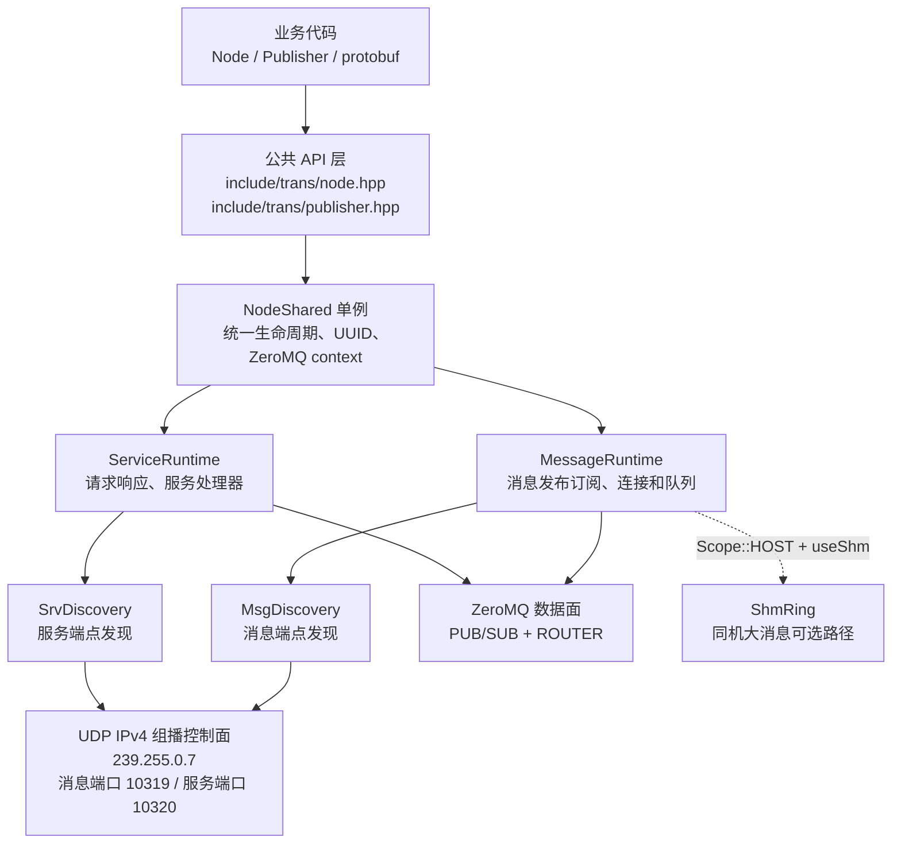
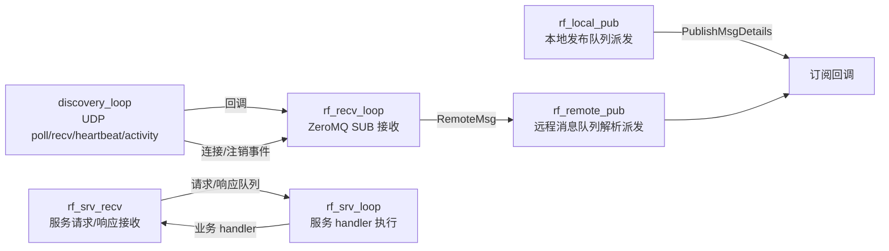
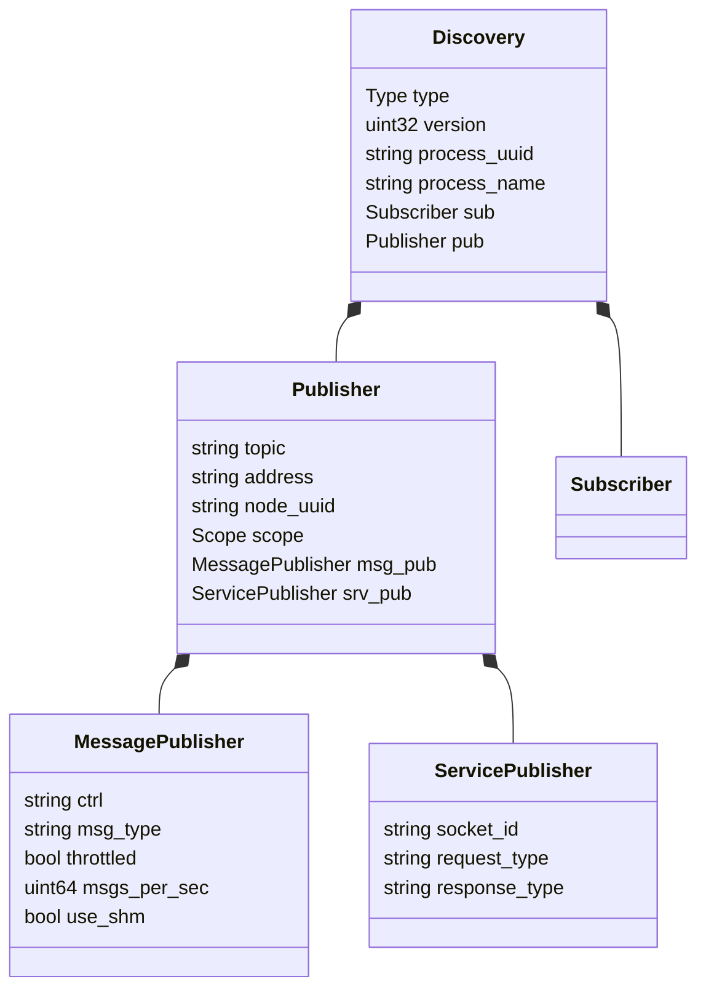
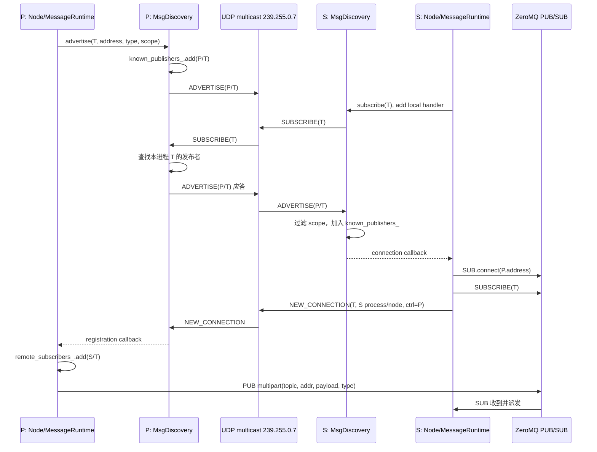
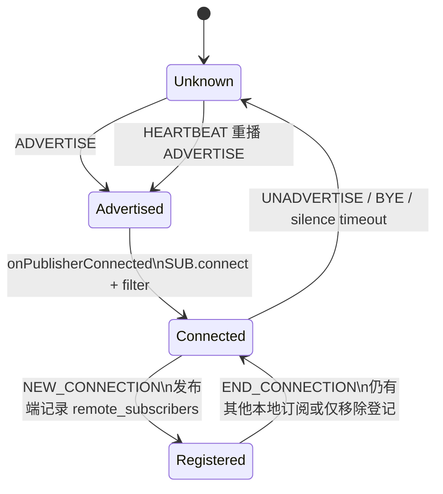

# rf_trans 架构

## 1. 一句话定位

`rf_trans` 是一个面向 C++17 的进程间通信库：业务 API 使用 `Node`、`Publisher` 和 protobuf 消息；控制面通过 UDP IPv4 组播自动发现端点；消息数据面使用 ZeroMQ PUB/SUB，服务数据面使用 ZeroMQ ROUTER；同机的大消息还可以使用共享内存环形队列。

核心设计是“发现和传输解耦”：UDP 只传播“谁提供什么、地址在哪里、谁订阅了什么”等元数据，真正的业务 payload 不经过组播网络。

## 2. 总体分层



### 2.1 主要对象职责

| 对象 | 位置 | 职责 |
| --- | --- | --- |
| `Node` | `include/trans/node.hpp` | 每个业务节点的门面对象；持有 `node_uuid`，记录本节点订阅/发布集合；析构时自动注销。 |
| `Publisher` | `include/trans/publisher.hpp` | 对一个 topic 的发布句柄；校验 protobuf 类型、限速，并委托 `NodeShared`。 |
| `NodeShared` | `src/node_shared.cc` | 进程级单例；创建 ZeroMQ context、消息/服务发现器和两个 runtime，统一启动/停止。 |
| `MessageRuntime` | `src/message_runtime.cc` | PUB/SUB socket、远端连接表、本地 handler、消息队列、共享内存路径。 |
| `ServiceRuntime` | `src/service_runtime.cc` | ROUTER requester/replier、请求/响应 handler、服务端点连接和异步队列。 |
| `Discovery<Pub>` | `include/trans/details/discovery.hpp` | UDP 组播 socket、protobuf 发现报文、已知端点存储、心跳与超时清理。 |
| `TopicStorage<Pub>` | `include/trans/details/topic_storage.hpp` | 按 `topic -> process_uuid -> publisher list` 组织发现结果，并提供线程安全查询。 |

一个进程中 `Node` 可以有多个，但共享同一个 `NodeShared`、ZeroMQ context、消息发现器和服务发现器；`Node` 的 UUID 用来区分进程内的不同业务节点。

## 3. 进程内启动与线程模型

首次构造 `Node` 时会懒加载 `NodeShared`。初始化顺序如下：

1. 生成进程 UUID，创建一个 ZeroMQ context。
2. 创建 `MsgDiscovery`（UDP 10319）和 `SrvDiscovery`（UDP 10320），默认组播地址为 `239.255.0.7`。
3. `MessageRuntime::initialize()` 创建并绑定 ZeroMQ `PUB` 随机 TCP 端口，保存实际 endpoint；创建 `SUB` socket。
4. `ServiceRuntime::initialize()` 创建并绑定 `ROUTER` replier 随机 TCP 端口，创建 requester `ROUTER`。
5. 启动发现线程、消息接收线程、本地派发线程、远程派发线程和服务处理线程。



停止时先停止两个 Discovery，防止发现回调继续触碰 runtime，再停止 service/message runtime；这是为了避免 teardown 竞态。

## 4. 消息发布订阅数据流

### 4.1 发布端

`Node::advertise<MessageT>(topic, options)` 根据 protobuf descriptor 生成全限定类型名，`MessageRuntime` 创建 `MessagePublisherInfo` 并调用 `Discovery::advertise()`。发布者信息包含：topic、ZeroMQ 地址、进程 UUID、Node UUID、消息类型、scope、限速和共享内存选项。

`Publisher::publish()` 依次执行：

1. 检查句柄有效。
2. 检查实际消息类型是否等于 advertise 类型。
3. 按 `msgs_per_sec` 做发布限速。
4. 查询本地订阅者和 `remote_subscribers_`。
5. 有远端订阅者时序列化并走 ZeroMQ PUB；如果是 `Scope::HOST + useShm`，优先写入 `ShmRing`，ZeroMQ 只发送共享内存描述符。
6. 有本地订阅者时，将消息和 handler 快照放入本地队列，由本地派发线程异步回调。

ZeroMQ 消息数据帧为四帧：

```text
[topic] [publisher_address] [protobuf bytes 或 ShmDescriptor] [msg_type]
```

### 4.2 订阅端

订阅先将 handler 放入 `local_subscribers_`，再调用 `Discovery::discover(topic)` 发送一次 `SUBSCRIBE`。收到远端 `ADVERTISE` 后，runtime 在其接收线程中生成命令，异步执行 `SUB.connect(address)` 和 `SUBSCRIBE topic`，避免在发现回调中直接操作 socket。

消息收到后按 topic/type 找到 handler，普通路径反序列化 protobuf；共享内存路径打开对应 ring，直接从槽内解析，并用序列号校验读期间是否被覆盖，校验失败则丢弃，不把撕裂数据交给业务回调。

## 5. 服务请求响应

服务发现复用同一 `Discovery` 模板，但使用独立 UDP 端口。服务端通过 `ServicePublisherInfo` 广播 topic、replier 地址、ROUTER socket id、请求类型和响应类型。

服务数据面使用 ROUTER 多帧协议：

```text
请求: [目标 socket id] [topic] [node_uuid] [request_uuid]
      [request bytes] [request type] [reply type]
响应: [客户端 routing id] [topic] [node_uuid] [request_uuid]
      [reply bytes] [result "1"/"0"]
```

请求优先查找本进程 handler；找不到时查发现表并连接服务端。请求和响应先进入队列，再由服务线程执行回调或通知请求 handler，因此 socket 收发线程不会直接执行用户业务代码。

## 6. UDP 发现机制详解

### 6.1 网络与 socket 初始化

- 组播组：`239.255.0.7`。
- 消息发现端口：`10319`；服务发现端口：`10320`。
- IPv4 UDP；构造时校验组播地址和端口范围。
- 默认从启用且支持组播的非回环网卡中选择地址；可用 `RF_HOST_IP` 强制指定网卡地址，适合多网卡、VPN、容器场景。
- socket 设置 `IP_MULTICAST_IF`、加入组播（`IP_ADD_MEMBERSHIP`）、`SO_REUSEADDR` 和 `SO_REUSEPORT`，并绑定 `0.0.0.0:<port>`。

发送端把 protobuf 序列化后加一个网络字节序的 `uint16` 长度前缀：

```text
UDP datagram = [2 bytes: protobuf length, network order]
                [N bytes: msgs.Discovery protobuf]
```

接收端先检查 datagram 长度是否等于 `2 + N`，再解析 protobuf；解析失败、长度不一致或版本/内容不合法的报文不会进入状态机。当前实现忽略 wire version 字段，版本演进需要后续补充兼容策略。

### 6.2 发现 protobuf

`msgs/discovery.proto` 的顶层字段包括：`version`、`process_uuid`、`process_name`、`type` 和一个 `oneof` 内容。



### 6.3 七类控制消息

| 类型 | 发送时机 | 接收端效果 |
| --- | --- | --- |
| `ADVERTISE` | 发布/服务注册；收到 `SUBSCRIBE` 的即时应答；心跳重播 | 按 scope 过滤后加入 `known_publishers_`；首次加入触发 connection callback。 |
| `SUBSCRIBE` | 本地订阅 topic | 远端若有该 topic 的发布者，重发匹配的 `ADVERTISE`；它是查询/唤醒，不是持久订阅表。 |
| `UNADVERTISE` | 发布者主动注销 | 删除对应 topic/process/node 记录，触发 disconnection callback。 |
| `NEW_CONNECTION` | 订阅端完成 ZeroMQ connect 和 topic filter 后 | 发布端检查 `ctrl == 自身 process_uuid`，将订阅端加入 `remote_subscribers_`。 |
| `END_CONNECTION` | 订阅端取消订阅 | 发布端按 topic + 订阅 process UUID + node UUID 删除远端订阅登记。 |
| `HEARTBEAT` | 默认每 1000 ms | 只刷新发送进程的最近活跃时间；同时重播本进程所有非 PROCESS 发布者。 |
| `BYE` | Discovery 析构 | 接收端立即删除该进程的发现记录并触发断开回调。 |

### 6.4 状态存储与去重

`known_publishers_` 使用：

```text
topic -> process_uuid -> vector<PublisherInfo>
```

去重键主要是 endpoint address + node UUID；进程 UUID 用于批量清理和路由。`last_seen_by_process_` 单独记录每个远端进程的最近发现报文时间，因此心跳和业务发现报文都能续租整个进程的存活状态。

### 6.5 Scope 过滤

| Scope | UDP 广播/接收规则 | 适用场景 |
| --- | --- | --- |
| `PROCESS` | 不发送 ADVERTISE；仅保存在本进程内 | 进程内快速通信，避免跨进程可见。 |
| `HOST` | 发送组播，但接收端仅接受同一 host address 或回环来源 | 同机跨进程；可安全使用共享内存。 |
| `ALL` | 接受网络中其他主机的发布者 | 跨主机通信，数据走 ZeroMQ TCP。 |

注意：`SUBSCRIBE` 本身是组播广播，发布端会依据发送者 IP 和 publisher scope 决定是否回 Advertise；因此 scope 约束同时存在于“发送应答”和“接收广告”两侧。

### 6.6 完整时序：发布端 P 与订阅端 S



`ADVERTISE` 表示“我能提供 T”；`NEW_CONNECTION` 表示“我已经完成数据面连接并且确实有本地订阅者”。只有后者写入发布端的 `remote_subscribers_`，所以发布端可在没有远端订阅时跳过序列化和网络发送。

### 6.7 心跳、超时和最终一致性

发现线程每次最多阻塞 `250 ms`，并按最近事件计算下一次 poll 超时：

- 活动检查默认每 `200 ms`。
- 心跳默认每 `1000 ms`，发送 `HEARTBEAT` 并重播非 PROCESS `ADVERTISE`。
- 默认 `3000 ms` 没有收到某进程任何发现报文，则删除该进程的所有发布者并触发 disconnection callback。
- `BYE` 用于正常退出时的快速清理；崩溃或断网则依赖 silence timeout。

这带来“最终一致”而非强一致：UDP 丢包不会永久破坏发现，因为心跳会重播广告；短暂网络抖动可能让端点在 3 秒后被删除，恢复后再通过广告重新建立连接。

## 7. 关键状态转换



需要区分两张表：订阅端的 `remote_publishers_` 表示“我知道且连接了哪些发布者”；发布端的 `remote_subscribers_` 表示“哪些远程订阅者使我需要发数据”。两者通过 UDP 控制消息间接同步，而不是共享内存或 RPC 强确认。

## 8. 并发、可靠性与边界

- Discovery 的 `known_publishers_`、回调指针和活跃时间表由 mutex 保护；回调通常在发现线程触发。
- ZeroMQ socket 不在多个业务线程直接并发操作：发现回调把连接/订阅动作放入 subscriber command 队列，由接收线程应用。
- 发布端用 `publisher_mutex_` 串行化 multipart send，避免四帧被不同线程交错。
- 本地消息、远程消息、服务请求/响应均采用有条件变量的队列与独立工作线程，降低 socket 线程被业务回调阻塞的风险。
- UDP 发现没有 ACK、重传、加密或认证；任何能访问组播网络的进程理论上都能伪造端点信息。生产环境应依赖可信网络，或在协议层增加签名/认证、TTL、白名单和版本协商。
- 发现报文使用单个 UDP datagram，长度字段为 `uint16`，实现上限约 64 KiB；过大的发现元数据会被拒绝。业务大 payload 不应塞进 UDP，而应使用 ZeroMQ/共享内存。
- 当前 `UNADVERTISE` 逻辑删除发现记录，但 ZeroMQ 物理 disconnect 主要依赖 socket 生命周期/底层行为；逻辑上不会再向该端点派发新数据。

## 9. 面试重点与可追问答案

**为什么不用 UDP 直接传业务消息？**

UDP 适合低成本广播发现，但不保证送达、顺序和不重复；业务数据需要 ZeroMQ 提供的连接、队列和 multipart framing。这样既保留自动发现，又避免把可靠传输和发现协议耦合。

**为什么要区分 ADVERTISE 和 NEW_CONNECTION？**

前者是能力声明，后者是数据面连接完成后的反向登记。发布端据此维护远程订阅者集合，在没有消费者时跳过序列化和发送，并支持一个 topic 多个 Node/进程的精确注销。

**启动顺序反过来会不会丢发现？**

首次 `ADVERTISE` 或 `SUBSCRIBE` 可能错过，但订阅会主动发送 `SUBSCRIBE`，发布端会即时应答；此外心跳周期性重播 `ADVERTISE`，所以最终仍能收敛。

**如何判断端点失效？**

按 `process_uuid` 维护最后活跃时间。心跳、广告、订阅等任何报文都会续租；超过 silence interval 整进程清理，避免只清理单个 topic 导致脏状态。

**为什么共享内存要求 HOST？**

共享内存对象只能被同机进程打开，跨主机发现即使拿到名字也无法访问。因此 `useShm` 只有在 `Scope::HOST` 时才启用，失败时回退到普通 ZeroMQ TCP 序列化路径。

## 10. 代码索引

- 公共 API：`include/trans/node.hpp`、`include/trans/publisher.hpp`
- 进程级装配：`src/node_shared.cc`
- UDP 发现核心：`include/trans/details/discovery.hpp`
- 发现协议：`msgs/discovery.proto`
- 消息数据面：`include/trans/details/message_runtime.hpp`、`src/message_runtime.cc`
- 服务数据面：`include/trans/details/service_runtime.hpp`、`src/service_runtime.cc`
- 端点存储：`include/trans/details/topic_storage.hpp`、`include/trans/details/publisher_info.hpp`
- 已有发现说明：`docs/discovery-mechanism.md`

